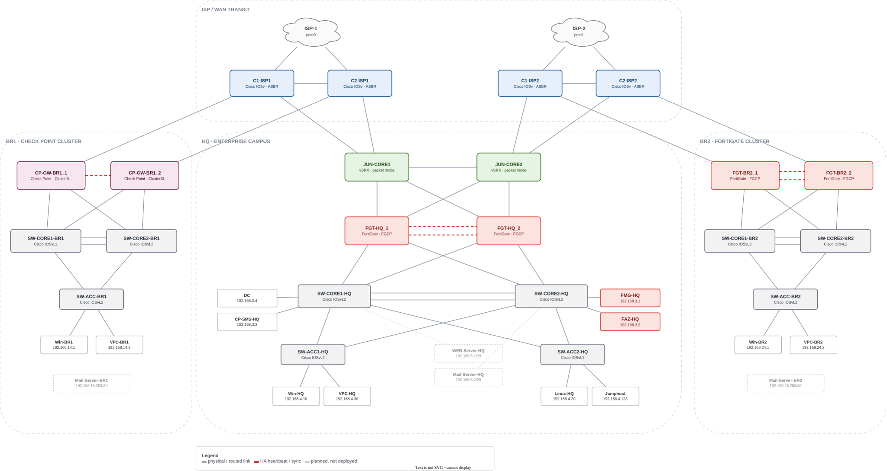

# MultiVendor Dual-ISP HA Enterprise VTI Lab

A resilient enterprise network in EVE-NG: HQ and two branches, dual ISP, and four vendors — Cisco IOS, Juniper vSRX (packet mode), FortiGate (FGCP), and Check Point (ClusterXL). The design follows the No Single Point of Failure principle.

**Goal:** remove single points of failure at every layer — dual-ISP with an ASBR pair, an active-active OSPF core, stateful HA clusters, duplicated VTI tunnels, and L2/L3 redundancy on the switching layer.

**Challenge:** make four platforms with different architectures behave as one network — align MTU on interconnects, prevent asymmetric routing on stateful firewalls, and provide deterministic path selection through OSPF cost/metrics.

When any component fails — from an access-switch cable to a whole ISP or the active firewall — the network recalculates paths and takes over sessions without manual intervention.

**Status:** Cisco ISP routers — complete; Juniper — in progress; Fortinet and Check Point — planned.

## Tools & Technologies

## Topology

## Addressing plan

| VM/Device       | Port    | Connected To (Peer)          | IP Address/Mask    | Comment                               |
| :--- | :--- | :--- | :--- | :--- |
| ISP-1           | pnet0   | C1-ISP1:gi0/0, C2-ISP1:gi0/0 | 172.16.172.254/24  |                                       |
| ISP-2           | pnet1   | C1-ISP2:gi0/0, C2-ISP2:gi0/0 | 172.16.172.254/24  |                                       |
| C1-ISP1         | gi0/0   | ISP-1:pnet0                  | 172.16.172.200/24  | NAT Outside                           |
| C1-ISP1         | gi0/1   | C2-ISP1:gi0/1                | 10.0.1.1/24        | OSPF Area 0, cost 20, P2P, NAT Inside |
| C1-ISP1         | gi0/2   | JUN-CORE1:ge-0/0/1           | 10.0.2.254/24      | OSPF Area 0, cost 10, P2P, NAT Inside |
| C1-ISP1         | gi0/3   | CP-GW-BR1_1:eth1             | 10.0.3.254/24      | OSPF Area 0, cost 10, P2P, NAT Inside |
| C2-ISP1         | gi0/0   | ISP-1:pnet0                  | 172.16.172.201/24  | NAT Outside                           |
| C2-ISP1         | gi0/1   | C1-ISP1:gi0/1                | 10.0.1.2/24        | OSPF Area 0, cost 20, P2P, NAT Inside |
| C2-ISP1         | gi0/2   | JUN-CORE1:ge-0/0/0           | 10.1.2.254/24      | OSPF Area 0, cost 10, P2P, NAT Inside |
| C2-ISP1         | gi0/3   | CP-GW-BR1_2:eth1             | 10.1.3.254/24      | OSPF Area 0, cost 10, P2P, NAT Inside |
| C1-ISP2         | gi0/0   | ISP-2:pnet1                  | 172.16.172.202/24  | NAT Outside                           |
| C1-ISP2         | gi0/1   | C2-ISP2:gi0/1                | 10.2.1.1/24        | OSPF Area 0, cost 20, P2P, NAT Inside |
| C1-ISP2         | gi0/2   | JUN-CORE2:ge-0/0/0           | 10.2.2.254/24      | OSPF Area 0, cost 10, P2P, NAT Inside |
| C1-ISP2         | gi0/3   | FGT-BR2_1:port3              | 10.2.3.254/24      | OSPF Area 0, cost 10, P2P, NAT Inside |
| C2-ISP2         | gi0/0   | ISP-2:pnet1                  | 172.16.172.203/24  | NAT Outside                           |
| C2-ISP2         | gi0/1   | C1-ISP2:gi0/1                | 10.2.1.2/24        | OSPF Area 0, cost 20, P2P, NAT Inside |
| C2-ISP2         | gi0/2   | JUN-CORE2:ge-0/0/1           | 10.3.2.254/24      | OSPF Area 0, cost 10, P2P, NAT Inside |
| C2-ISP2         | gi0/3   | FGT-BR2_2:port3              | 10.3.3.254/24      | OSPF Area 0, cost 10, P2P, NAT Inside |
| JUN-CORE1       | ge0/0/0 | C2-ISP1:gi0/2                | 10.1.2.1/24        |                                       |
| JUN-CORE1       | ge0/0/1 | C1-ISP1:gi0/2                | 10.0.2.1/24        |                                       |
| JUN-CORE1       | ge0/0/2 | FGT-HQ_1:port1               | 192.168.100.254/24 |                                       |
| JUN-CORE1       | ge0/0/3 | FGT-HQ_2:port2               | 192.168.110.254/24 |                                       |
| JUN-CORE1       | ge0/0/4 | JUN-CORE2:ge-0/0/4           | 10.100.100.1/24    | MGMT                                  |
| JUN-CORE2       | ge0/0/0 | C1-ISP2:gi0/2                | 10.2.2.1/24        |                                       |
| JUN-CORE2       | ge0/0/1 | C2-ISP2:gi0/2                | 10.3.2.1/24        |                                       |
| JUN-CORE2       | ge0/0/2 | FGT-HQ_2:port1               | 192.168.200.254/24 |                                       |
| JUN-CORE2       | ge0/0/3 | FGT-HQ_1:port2               | 192.168.210.254/24 |                                       |
| JUN-CORE2       | ge0/0/4 | JUN-CORE1:ge-0/0/4           | 10.100.100.2/24    | MGMT                                  |
| FGT-HQ_1        | port1   | JUN-CORE1:ge-0/0/2           | 192.168.100.1/24   |                                       |
| FGT-HQ_1        | port2   | JUN-CORE2:ge-0/0/3           | 192.168.200.1/24   |                                       |
| FGT-HQ_1        | port3   | FGT-HQ_2:port3               | 192.168.2.1/24     |                                       |
| FGT-HQ_1        | port4   | FGT-HQ_2:port4               | 192.168.2.3/24     |                                       |
| FGT-HQ_1        | port5   | SW-CORE2-HQ:Gi0/0            | 192.168.3.254/24   | SRV                                   |
| FGT-HQ_1        | port6   | SW-CORE1-HQ:Gi0/1            | 192.168.4.254/24   | USR                                   |
| FGT-HQ_1        | port7   | SW-CORE1-HQ:Gi1/1            | 192.168.5.6/29     | DMZ                                   |
| FGT-HQ_2        | port1   | JUN-CORE2:ge-0/0/2           | 192.168.100.1/24   |                                       |
| FGT-HQ_2        | port2   | JUN-CORE1:ge-0/0/3           | 192.168.200.1/24   |                                       |
| FGT-HQ_2        | port3   | FGT-HQ_1:port3               | 192.168.2.2/24     |                                       |
| FGT-HQ_2        | port4   | FGT-HQ_1:port4               | 192.168.2.4/24     |                                       |
| FGT-HQ_2        | port5   | SW-CORE1-HQ:Gi0/0            | 192.168.3.254/24   | SRV                                   |
| FGT-HQ_2        | port6   | SW-CORE2-HQ:Gi0/1            | 192.168.4.254/24   | USR                                   |
| FGT-HQ_2        | port7   | SW-CORE2-HQ:Gi1/1            | 192.168.5.6/29     | DMZ                                   |
| FMG-HQ          | port1   | SW-CORE2-HQ:Gi0/2            | 192.168.3.1/24     | SRV                                   |
| FAZ-HQ          | port1   | SW-CORE2-HQ:Gi0/3            | 192.168.3.2/24     | SRV                                   |
| FGT-BR2_1       | port1   | FGT-BR2_2:port1              | 192.168.2.5/24     |                                       |
| FGT-BR2_1       | port2   | FGT-BR2_2:port2              | 192.168.2.6/24     |                                       |
| FGT-BR2_1       | port3   | C1-ISP2:gi0/3                | 10.2.3.1/24        |                                       |
| FGT-BR2_1       | port4   | SW-CORE1-BR2:Gi0/0           | 192.168.23.254/24  | SRV                                   |
| FGT-BR2_1       | port5   | SW-CORE1-BR2:Gi0/1           | 192.168.24.254/24  | USR                                   |
| FGT-BR2_1       | port6   | SW-CORE2-BR2:Gi0/3           | 192.168.25.254/30  | DMZ                                   |
| FGT-BR2_2       | port1   | FGT-BR2_1:port1              | 192.168.2.7/24     |                                       |
| FGT-BR2_2       | port2   | FGT-BR2_1:port2              | 192.168.2.8/24     |                                       |
| FGT-BR2_2       | port3   | C2-ISP2:gi0/3                | 10.3.3.1/24        |                                       |
| FGT-BR2_2       | port4   | SW-CORE2-BR2:Gi0/0           | 192.168.23.254/24  | SRV                                   |
| FGT-BR2_2       | port5   | SW-CORE2-BR2:Gi0/1           | 192.168.24.254/24  | USR                                   |
| FGT-BR2_2       | port6   | SW-CORE1-BR2:Gi0/3           | 192.168.25.254/30  | DMZ                                   |
| CP-GW-BR1_1     | eth0    | CP-GW-BR1_2:eth0             | 192.168.12.1/24    |                                       |
| CP-GW-BR1_1     | eth1    | C1-ISP1:gi0/3                | 10.0.3.1/24        |                                       |
| CP-GW-BR1_1     | eth2    | SW-CORE1-BR1:Gi0/0           | 192.168.13.254/24  | SRV                                   |
| CP-GW-BR1_1     | eth3    | SW-CORE1-BR1:Gi0/1           | 192.168.14.254/24  | USR                                   |
| CP-GW-BR1_1     | eth4    | SW-CORE2-BR1:Gi0/3           | 192.168.15.254/24  | DMZ                                   |
| CP-GW-BR1_2     | eth0    | CP-GW-BR1_1:eth0             | 192.168.12.2/24    |                                       |
| CP-GW-BR1_2     | eth1    | C2-ISP1:gi0/3                | 10.1.3.1/24        |                                       |
| CP-GW-BR1_2     | eth2    | SW-CORE2-BR1:Gi0/0           | 192.168.13.254/24  | SRV                                   |
| CP-GW-BR1_2     | eth3    | SW-CORE2-BR1:Gi0/1           | 192.168.14.254/24  | USR                                   |
| CP-GW-BR1_2     | eth4    | SW-CORE1-BR1:Gi0/3           | 192.168.15.254/24  | DMZ                                   |
| CP-SMS-HQ       | eth0    | SW-CORE1-HQ:Gi0/2            | 192.168.3.3/24     | SRV                                   |
| WEB-Server-HQ   | e0      | — (not deployed)             | 192.168.5.1/29     | DMZ                                   |
| Mail-Server-HQ  | e0      | — (not deployed)             | 192.168.5.2/29     | DMZ                                   |
| Mail-Server-BR1 | e0      | — (not deployed)             | 192.168.15.253/30  | DMZ                                   |
| Mail-Server-BR2 | e0      | — (not deployed)             | 192.168.25.253/30  | DMZ                                   |
| Jumphost        | e0      | SW-ACC2-HQ:Gi0/1             | 192.168.4.123/24   | USR                                   |
| DC              | e0      | SW-CORE1-HQ:Gi0/3            | 192.168.3.4/24     | SRV                                   |
| Win-HQ          | e0      | SW-ACC1-HQ:Gi0/3             | 192.168.4.10/24    | USR                                   |
| Win-BR1         | e0      | SW-ACC-BR1:Gi0/2             | 192.168.14.1/24    | USR                                   |
| Win-Br2         | e0      | SW-ACC-BR2:Gi0/3             | 192.168.24.1/24    | USR                                   |
| Linux-HQ        | e0      | SW-ACC2-HQ:Gi0/2             | 192.168.4.20/24    | USR                                   |
| VPC-HQ          | eth0    | SW-ACC1-HQ:Gi0/1             | 192.168.4.30/24    | USR                                   |
| VPC-BR1         | eth0    | SW-ACC-BR1:Gi0/3             | 192.168.14.2/24    | USR                                   |
| VPC-BR2         | eth0    | SW-ACC-BR2:Gi0/2             | 192.168.24.2/24    | USR                                   |

`Comment` carries the security zone (`USR`, `SRV`, `DMZ`, `MGMT`) and the interface role. Links without a zone are WAN, transit, or HA.

### Router IDs

| Router    | Router ID      | Loopback0         |
| :--- | :--- | :--- |
| `C1-ISP1` | `10.255.255.1` | `10.255.255.1/32` |
| `C2-ISP1` | `10.255.255.2` | `10.255.255.2/32` |
| `C1-ISP2` | `10.255.255.3` | `10.255.255.3/32` |
| `C2-ISP2` | `10.255.255.4` | `10.255.255.4/32` |
| `JUN-CORE1`|`10.255.255.5`|`10.255.255.5/32`|
| `JUN-CORE2`|`10.255.255.6`|`10.255.255.6/32`|

## Author

Arthur Balenski — [github.com/Dflaming0](https://github.com/Dflaming0)

## License

Apache License 2.0 — see [`LICENSE`](LICENSE).
